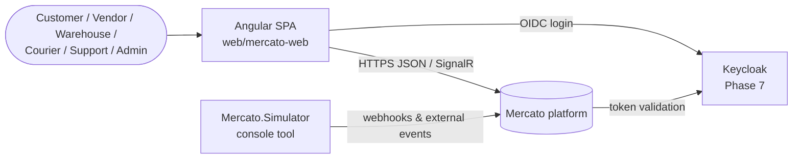
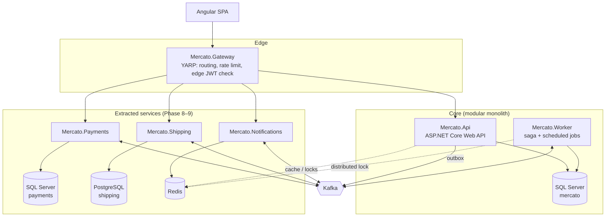
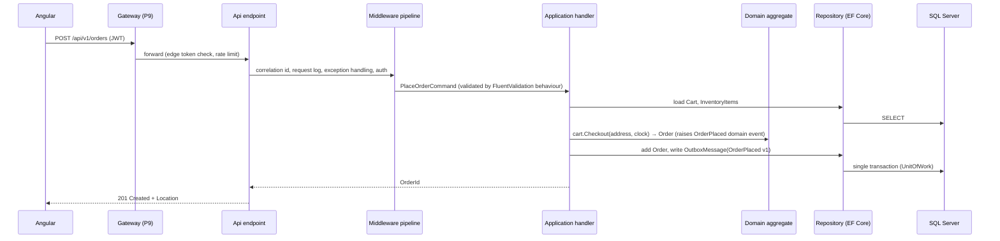
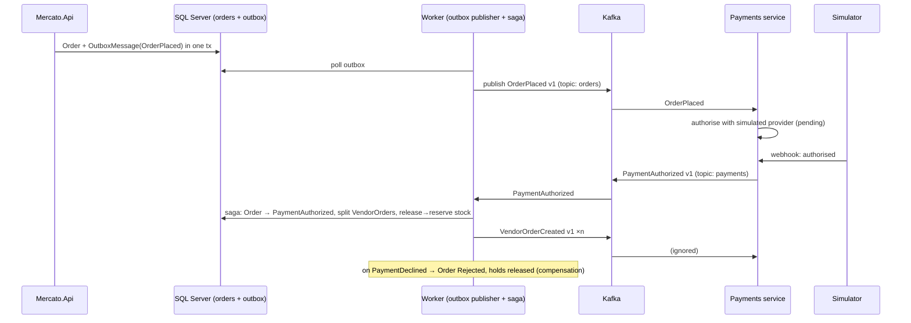
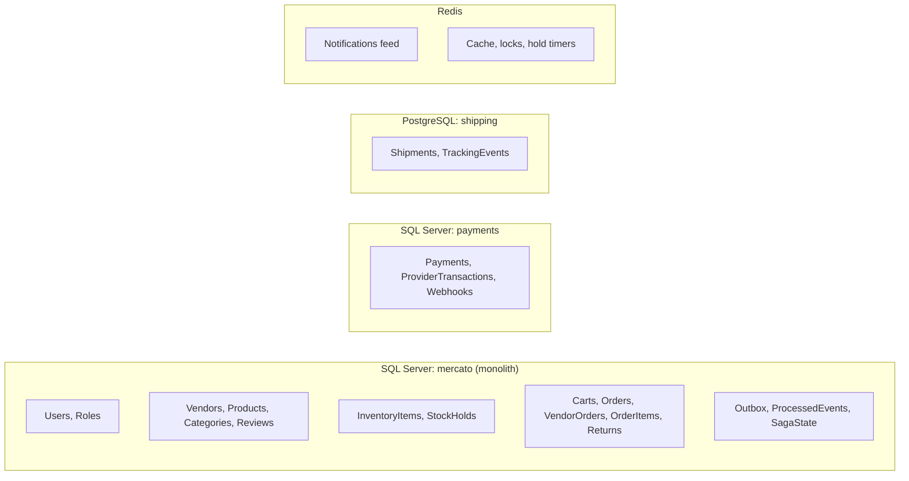
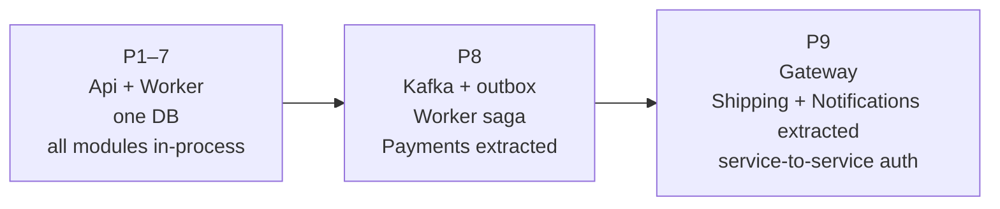

# Mercato – Architecture & Technical Requirements

> Developer-facing companion to `REQUIREMENTS.md` (what the system does) and `PLAN.md`
> (how and when it is built). This file describes **how the system is structured**: deployables,
> projects, modules, dependencies, data flow, data ownership and cross-cutting concerns.
> Diagrams are Mermaid (rendered by GitHub and VS Code).
> Status: **draft v0.1** (Phase 1). Updated whenever a phase changes the structure.
> Last updated: 2026-10-27

Technical requirement IDs: `TR-<nn>`. Architecture tests (Phase 11) enforce the ones marked ⚙.

---

## 1. Architectural style in one paragraph

Mercato is a **modular monolith** built with **Clean Architecture** layering, whose three
integration-heavy modules (Payments, Shipping, Notifications) are later **extracted into
services** that communicate through **Kafka events** behind a **YARP gateway**. The monolith
keeps a single SQL Server database; each extracted service owns its own store. Cross-service
workflows (the order saga) are coordinated by a **Worker** that consumes events, and all
publication goes through an **outbox** so no event is lost. The style is chosen to show the
real-world path from a well-structured monolith to microservices, not to start distributed.

---

## 2. System context



External parties (payment provider, warehouse scanners, couriers, e-mail) do not exist; the
Simulator plays all of them by calling the same endpoints / topics a real integration would.

---

## 3. Deployables (container view, final state after Phase 9)



| Deployable | Kind | Phase | Store | Responsibility |
|---|---|---|---|---|
| `Mercato.Api` | ASP.NET Core Web API | 1 (shell), 3 | SQL Server `mercato` | HTTP API for Identity, Catalog, Inventory, Ordering |
| `Mercato.Worker` | Worker Service | 1 (shell), 8 | SQL Server `mercato` | order saga, outbox publisher, scheduled jobs |
| `Mercato.Gateway` | YARP reverse proxy | 9 | – | single entry point, routing, rate limiting, edge token validation |
| `Mercato.Payments` | Web API + consumer | 8 | SQL Server `payments` | authorise / capture / refund via simulated provider; webhooks |
| `Mercato.Shipping` | Web API + consumer | 9 | PostgreSQL `shipping` | shipments, courier tracking |
| `Mercato.Notifications` | Web API + consumer + SignalR hub | 9 | Redis | consume events, e-mail (logged), push |
| `web/mercato-web` | Angular SPA (static files) | 1 (skeleton), 5 | – | UI for all roles |
| `tools/Mercato.Simulator` | console | 8 | – | external-system simulation, demo data |

Until Phase 8 only `Api`, `Worker`, SQL Server (and from Phase 6 Seq) run; the Angular app
calls `Mercato.Api` directly. Until Phase 9 there is no gateway.

---

## 4. Projects and the dependency rule

### 4.1 Core solution projects (Phase 1)

```mermaid
flowchart BT
    Domain[Mercato.Domain<br/>entities, value objects, domain events,<br/>domain exceptions, invariants]
    Contracts[Mercato.Contracts<br/>integration events, DTOs,<br/>versioned, no logic]
    Application[Mercato.Application<br/>commands/queries + handlers,<br/>validators, ports (interfaces),<br/>module facades]
    Infrastructure[Mercato.Infrastructure<br/>EF Core DbContext, repositories,<br/>outbox, Kafka, clock, e-mail,<br/>simulated payment adapter]
    Api[Mercato.Api<br/>endpoints, middleware,<br/>auth, OpenAPI, DI composition]
    Worker[Mercato.Worker<br/>saga, outbox publisher,<br/>scheduled jobs, DI composition]

    Application --> Domain
    Application --> Contracts
    Infrastructure --> Application
    Api --> Application
    Api --> Infrastructure
    Worker --> Application
    Worker --> Infrastructure
```

Arrows mean "references" (and therefore "may use types from"). Compile-time enforcement: a
project cannot use a type from a project it does not reference.

| ID | Rule | ⚙ |
|---|---|---|
| TR-01 | `Mercato.Domain` references **no** project and no framework package except the BCL. No EF Core, no ASP.NET, no MediatR. | ⚙ |
| TR-02 | `Mercato.Contracts` references nothing and contains only plain records/classes (events, DTOs) and enums. No logic. | ⚙ |
| TR-03 | `Mercato.Application` references Domain and Contracts only. It defines the **ports** (interfaces) that Infrastructure implements, e.g. `IOrderRepository`, `IPaymentGateway`, `IUnitOfWork`, `TimeProvider`. | ⚙ |
| TR-04 | `Mercato.Infrastructure` references Application (and transitively Domain, Contracts). It never references Api or Worker. | ⚙ |
| TR-05 | `Mercato.Api` and `Mercato.Worker` are **composition roots**: they wire DI and host the process. They contain no business logic. | ⚙ |
| TR-06 | Extracted services (`services/*`) reference **only** `Mercato.Contracts` — never Domain, Application or Infrastructure. | ⚙ |
| TR-07 | Tests reference the project under test; integration tests may reference Api/Worker (`WebApplicationFactory`). | |
| TR-08 | Shared build settings live in `Directory.Build.props` (target framework, nullable, implicit usings, analyzers, warnings as errors); package versions live in `Directory.Packages.props` (Central Package Management). Individual `.csproj` files contain no versions and no analyzer settings. | |

### 4.2 Repository layout

```
C:\MERCATO Repo\
├─ Mercato.sln(x), global.json, Directory.Build.props, Directory.Packages.props
├─ .editorconfig, .gitattributes, .gitignore, CLAUDE.md, README.md
├─ docs/            PLAN.md, DECISIONS.md, REQUIREMENTS.md, ARCHITECTURE.md, Rules/
├─ src/             Mercato.Domain, Mercato.Contracts, Mercato.Application,
│                   Mercato.Infrastructure, Mercato.Api, Mercato.Worker, Mercato.Gateway (P9)
├─ services/        Mercato.Payments (P8), Mercato.Shipping (P9), Mercato.Notifications (P9)
├─ tests/           Mercato.Domain.Tests, Mercato.Application.Tests,
│                   Mercato.Api.IntegrationTests, Mercato.Architecture.Tests
├─ tools/           Mercato.Simulator (P8)
├─ web/mercato-web/ Angular app (own package.json; not part of the .sln)
├─ deploy/          compose/ (P6), k8s/ (P13), azure/ (P14)
└─ .github/workflows/  (P12), azure-pipelines.yml (P12)
```

---

## 5. Modules inside the monolith

A **module** is a business area (see `REQUIREMENTS.md` §4). Inside the monolith a module is
not a project but a **folder with the same name in each layer**, so the code of one area is
easy to find and easy to extract later.

```
Mercato.Domain/            Mercato.Application/        Mercato.Infrastructure/
├─ Common/                 ├─ Common/                  ├─ Persistence/
│  ├─ Entity.cs            │  ├─ Behaviours/ (validation, logging, transaction)
│  ├─ AggregateRoot.cs     │  ├─ Abstractions/ (ICommand, IQuery, IUnitOfWork, ...)
│  ├─ ValueObject.cs       │  └─ Exceptions/           │  ├─ MercatoDbContext.cs
│  ├─ IDomainEvent.cs      ├─ Identity/                │  ├─ Configurations/<Module>/
│  └─ MercatoException.cs  ├─ Catalog/                 │  ├─ Repositories/<Module>/
├─ Identity/               │  ├─ Products/             │  └─ Migrations/
├─ Catalog/                │  │  ├─ CreateProduct/     ├─ Messaging/ (outbox, Kafka producer/consumer)
│  ├─ Vendor.cs            │  │  │  ├─ CreateProductCommand.cs
│  ├─ Product.cs           │  │  │  ├─ CreateProductHandler.cs
│  ├─ Category.cs          │  │  │  └─ CreateProductValidator.cs
│  └─ Review.cs            │  │  └─ GetProductById/    ├─ Identity/ (Identity stores, JWT)
├─ Inventory/              │  └─ Vendors/              ├─ Payments/ (simulated provider adapter)
│  ├─ InventoryItem.cs     ├─ Inventory/               ├─ Time/ (SystemTimeProvider)
│  └─ StockHold.cs         ├─ Ordering/                └─ DependencyInjection.cs
├─ Ordering/               ├─ Payments/   (→ service P8)
│  ├─ Cart.cs              ├─ Shipping/   (→ service P9)
│  ├─ Order.cs             └─ Notifications/ (→ service P9)
│  ├─ VendorOrder.cs
│  ├─ OrderItem.cs
│  └─ Return.cs
├─ Payments/      Payment.cs
├─ Shipping/      Shipment.cs
└─ Notifications/ Notification.cs
```

Conventions:

| ID | Rule | ⚙ |
|---|---|---|
| TR-10 | One folder per module in Domain, Application and Infrastructure; the folder name is the namespace leaf (`Mercato.Domain.Ordering`). | |
| TR-11 | Application code is organised **by feature** (vertical slice inside the module): one folder per use case holding command/query, handler and validator. | |
| TR-12 | **Modules do not reference each other's domain types.** Cross-module needs go through (a) an application-layer interface owned by the calling module and implemented by the other (`IStockReservationService`), or (b) a domain/integration event. Ordering never touches `InventoryItem` directly. | ⚙ |
| TR-13 | Each aggregate root is the only entry point to its aggregate; repositories exist per aggregate root only. | |
| TR-14 | Aggregates per module: Identity → `User`; Catalog → `Vendor`, `Product` (with `Review`), `Category`; Inventory → `InventoryItem` (with `StockHold`); Ordering → `Cart`, `Order` (with `VendorOrder`, `OrderItem`), `Return`; Payments → `Payment`; Shipping → `Shipment`; Notifications → `Notification`. Refined in Phase 2. | |
| TR-15 | Every vendor-owned aggregate carries `VendorId`; tenancy is enforced by an application behaviour/global query filter, never left to the UI (`REQUIREMENTS.md` BR-02). | |

---

## 6. Request flow (synchronous)



| ID | Rule |
|---|---|
| TR-20 | **CQRS, in-process:** every use case is a command (writes) or a query (reads) with exactly one handler. Mediator: MediatR or a hand-written one (open question, Phase 3). Queries may bypass the domain and read via EF projections. |
| TR-21 | **Pipeline behaviours** (cross-cutting around handlers): validation (FluentValidation), logging, transaction/unit-of-work for commands, tenancy enforcement. |
| TR-22 | **Middleware** (cross-cutting around HTTP): correlation ID, request logging, global exception → ProblemDetails, authentication/authorisation, rate limiting (gateway from P9). |
| TR-23 | **API shape:** REST, versioned by URL segment (`/api/v1`), `Asp.Versioning`, OpenAPI document per version, RFC 9457 ProblemDetails for all errors, pagination via `page`/`pageSize` with total count. |
| TR-24 | Domain events are raised inside aggregates and dispatched after the aggregate is saved (same transaction); integration events are written to the **outbox table** in the same transaction and published by the Worker. |

---

## 7. Event flow (asynchronous, Phase 8+)



| ID | Rule |
|---|---|
| TR-30 | **Outbox pattern** for every publisher: event rows written transactionally with the state change; a background publisher pushes them to Kafka and marks them sent. At-least-once delivery. |
| TR-31 | **Idempotent consumers:** every event carries an `EventId`; consumers record processed IDs and skip duplicates. |
| TR-32 | **Saga in the Worker** (orchestration): the order lifecycle (`REQUIREMENTS.md` §5.1) is driven by events, with persisted saga state and explicit compensation steps. |
| TR-33 | **Topics** by module: `orders`, `payments`, `shipping`, `notifications`; key = aggregate id so events of one order stay ordered within a partition. |
| TR-34 | **Contracts versioning:** events and DTOs live in `Mercato.Contracts` under `V1/`, `V2/` namespaces; a breaking change adds a new version and the producer publishes both until consumers migrated. Never edit a published contract in place. |
| TR-35 | Scheduled jobs (hold expiry, payouts, abandoned carts, index rebuild) run in the Worker (`BackgroundService` or Quartz); when the Worker runs with 2+ replicas (P13) a **Redis distributed lock** guarantees a job runs once. |

---

## 8. Data ownership



| ID | Rule |
|---|---|
| TR-40 | One database per deployable owner; **no cross-database joins and no shared tables**. A service that needs another's data gets it from events (local copy) or an API call through the gateway. |
| TR-41 | Monolith schema: one EF Core `MercatoDbContext`, one schema per module (`identity.`, `catalog.`, `inventory.`, `ordering.`) so extraction later is a schema move, not a table hunt. |
| TR-42 | EF Core **code-first**, migrations in `Mercato.Infrastructure/Persistence/Migrations`, applied by the API at startup in Development and by a migration step in pipelines/compose otherwise. |
| TR-43 | Concurrency: `rowversion` on `InventoryItem` (optimistic); the last-unit race is resolved by a retried `UPDATE … WHERE available >= @qty` inside the hold transaction. Redis locks are added only where the DB cannot help (multi-instance jobs). |
| TR-44 | Money: `decimal(18,2)` + ISO currency code value object; UTC `datetime2` for all timestamps; soft delete (`IsActive`) for business records. |
| TR-45 | IDs: `Guid` (v7, sequential) primary keys; human-facing order numbers generated separately. |

---

## 9. Cross-cutting concerns

| Concern | Decision | Phase |
|---|---|---|
| **Authentication** | P4: ASP.NET Core Identity + own JWT (access 15 min, refresh 7 days, rotation). P7: Keycloak OIDC, Authorization Code + PKCE in Angular; API validates Keycloak JWTs; service-to-service via client-credentials tokens. | 4, 7 |
| **Authorisation** | Role claims → ASP.NET policies (`RequireVendor`, `RequireSupport`…); resource-based checks for ownership; vendor tenancy enforced in Application (TR-15). | 4 |
| **Validation** | FluentValidation on commands/queries via pipeline behaviour → 400 ProblemDetails with field errors. | 3 |
| **Errors** | Domain exceptions derive from `MercatoException`; global middleware maps: `NotFound*` → 404, `Validation` → 400, `Concurrency` → 409, `Forbidden` → 403, rest → 500 with correlation id. | 3 |
| **Logging** | `ILogger<T>` + Serilog, JSON to console, Seq sink in Development; correlation id enricher; levels per `GeneralRules.md` §8. | 3 |
| **Tracing/metrics** | OpenTelemetry: ASP.NET, HttpClient, EF Core, Kafka instrumentation; OTLP exporter (Aspire dashboard or Jaeger locally). | 10 |
| **Resilience** | Polly via `Microsoft.Extensions.Http.Resilience` for outgoing HTTP; retry with jitter; circuit breaker for the simulated provider. | 10 |
| **Caching** | Redis (`IDistributedCache` / `HybridCache`) for catalog reads; explicit invalidation on product change. | 10 |
| **Health** | `/health/live`, `/health/ready` (DB, Kafka, Redis checks) per deployable. | 10 |
| **Configuration** | `appsettings.json` (defaults) → `appsettings.{Env}.json` → environment variables → `dotnet user-secrets` in Development. No secrets in Git (GR-31). | 1–3 |
| **API docs** | OpenAPI per version, Swagger UI / Scalar in Development only. | 3 |
| **Real-time** | SignalR hub in Notifications service; Angular client with token auth. | 9 |

---

## 10. Frontend architecture (Angular)

| ID | Rule |
|---|---|
| TR-50 | Standalone components, signals for state, `inject()` DI, OnPush change detection. No NgModules. |
| TR-51 | Folder layout: `core/` (auth, interceptors, guards, API clients), `shared/` (UI components, pipes), `features/<area>/` (catalog, cart, checkout, orders, vendor, warehouse, support, admin) — each feature lazy-loaded by route. |
| TR-52 | API access through typed client services generated or hand-written against the OpenAPI document; one `HttpInterceptor` adds the token and refreshes it; another maps ProblemDetails to UI errors. |
| TR-53 | Auth: P4–6 custom JWT flow; P7 `angular-oauth2-oidc` with PKCE against Keycloak. Role guards on routes; role-aware navigation. |
| TR-54 | Angular Material for UI; responsive layout; environment files for API base URL. |
| TR-55 | Unit tests with the Angular CLI test runner; optional Playwright e2e against docker-compose. |

---

## 11. Environments

| Environment | How it runs | Phase |
|---|---|---|
| **Local dev** | API/Worker from Visual Studio (`dotnet run`), SQL Server/Kafka/Redis/Seq from `deploy/compose/infra.yml`, Angular via `ng serve`. | 2, 6 |
| **Local full stack** | `docker compose up` in `deploy/compose/`: all infra + all apps, multi-stage Dockerfiles. | 6 |
| **Local Kubernetes** | Helm chart in `deploy/k8s/` on Docker Desktop / kind; Worker scaled to 2 to demonstrate the distributed lock. | 13 |
| **Azure** | Bicep in `deploy/azure/`: Container Apps (API, Worker, services, gateway), Azure SQL free tier, Static Web Apps (Angular), Event Hubs (Kafka protocol) or Kafka container; GitHub Actions deploy. | 14 |
| **CI** | GitHub Actions: build + test on PR, image build + push to GHCR on main, one workflow per deployable with path filters; Azure Pipelines mirror. | 12 |

---

## 12. Evolution path: monolith → services



Extraction recipe (applied three times): the module already talks to the rest only via
Application interfaces and events (TR-12) → move its Domain/Application/Infrastructure folders
into a new project under `services/` → replace the in-process interface implementation in the
monolith with an event-based one → move its tables to the service's own database → route its
endpoints through the gateway. Nothing else changes.

---

## 13. Quality gates

| ID | Requirement | Phase |
|---|---|---|
| TR-60 | Build with analyzers `latest-recommended`, warnings as errors, nullable enabled, in every project (via `Directory.Build.props`). | 1 |
| TR-61 | Architecture tests (`Mercato.Architecture.Tests`, NetArchTest or ArchUnitNET) fail the build on any violation of TR-01…06 and TR-12. | 11 |
| TR-62 | Unit tests for Domain and Application without a database; integration tests with Testcontainers SQL Server (and Kafka from P8); test naming and levels per `GeneralRules.md` §10. | 11 |
| TR-63 | PR gate in CI: build, test, (later) container build. No direct pushes to `main` once CI exists. | 12 |

---

## 14. Open technical questions

- Mediator: MediatR (license change in v13) vs. hand-written `ISender` — Phase 3.
- Controllers vs. minimal APIs with endpoint groups — Phase 3 (leaning minimal APIs + `Asp.Versioning.Http`).
- Scheduled jobs: plain `BackgroundService` with `PeriodicTimer` vs. Quartz.NET — Phase 8.
- Angular API client: NSwag/openapi-generator vs. hand-written — Phase 5.
- Keycloak vs. Entra ID for the cloud deployment — Phase 14.

---

## 15. V1 footprint

`REQUIREMENTS-V1.md` does **not** change this architecture; it only reduces what is built inside
it. Everything in §1–§13 applies to V1 unchanged. The V1 footprint:

| Area | V1 | Grows to (final) |
|---|---|---|
| Aggregates | `User`, `Vendor`, `Category`, `Product`, `InventoryItem`+`StockHold`, `Cart`, `Order`+`VendorOrder`+`OrderItem`, `Payment`, `Shipment`, `Notification` | + `Return`, `Review`, `Payout` |
| Order states | `Placed`, `Paid`, `Rejected`, `Completed`; VendorOrder `Pending`, `Shipped`, `Delivered` | + `PaymentAuthorized`, `Picked`, `Cancelled`, `ReturnRequested`, `Refunded` |
| Payments port | `IPaymentGateway.ChargeAsync` (one step) | `AuthorizeAsync`, `CaptureAsync`, `RefundAsync`, `VoidAsync` |
| Shipping | vendor action "mark shipped" → `Shipment`; one courier event `delivered` | pick/pack steps, full tracking events |
| Roles | `Customer`, `Vendor`, `Admin` used; `WarehouseOperator`, `Courier`, `SupportAgent` defined but unused | all six with their endpoints and screens |
| Worker jobs | hold expiry; outbox publisher; saga | + payouts, abandoned carts, index rebuild |
| Events (Contracts V1) | `OrderPlaced`, `PaymentSucceeded`, `PaymentDeclined`, `VendorOrderShipped`, `ShipmentDelivered` | + authorised/captured/refunded, return events, … |

Adding an increment from `REQUIREMENTS-V1.md` §8 means adding handlers, states and events to
existing modules — never a new layer, project type or communication style.
