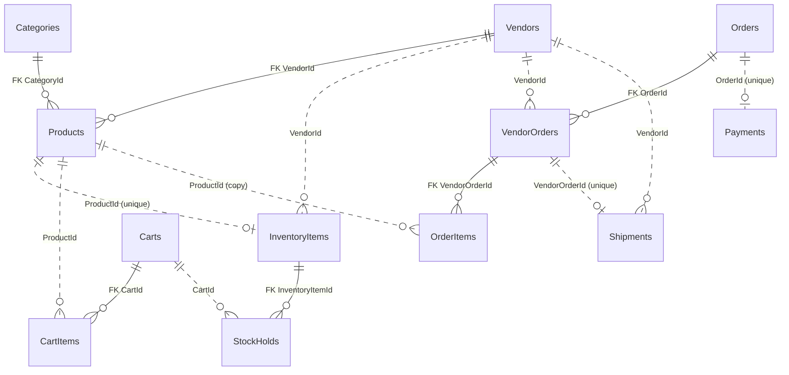

# Mercato – Database Architecture

> The relational schema of the `mercato` SQL Server database: schemas, tables, columns,
> relationships and the constraints that enforce business rules.
> **Source of truth:** the EF Core configurations in
> `src/Mercato.Infrastructure/Persistence/Configurations/` and, once created, the migrations.
> This document explains them; if they disagree, the code wins and this file gets fixed.

**Status (Phase 2, closed 2026-11-08):** all six schemas are mapped in code and the `InitialCreate`
migration has been applied to SQL Server 2022 in Docker. Checked in SSMS: 6 schemas, 13 tables, 17
indexes; every foreign key stays inside its module; `__EFMigrationsHistory` holds `InitialCreate`.
The real schema matches the tables below.

---

## 1. Overview

One SQL Server database (`mercato`, running in Docker) holds all modules of the modular monolith.
Each module owns **one schema**, so the boundaries are visible in the database and a module can be
extracted into its own service later (TR-41).

| Schema | Module | Tables | Aggregate roots |
|---|---|---|---|
| `catalog` | Catalog | `Vendors`, `Categories`, `Products` | `Vendor`, `Category`, `Product` |
| `inventory` | Inventory | `InventoryItems`, `StockHolds` | `InventoryItem` (owns `StockHold`) |
| `ordering` | Ordering | `Carts`, `CartItems`, `Orders`, `VendorOrders`, `OrderItems` | `Cart` (owns `CartItem`), `Order` (owns `VendorOrder`, which owns `OrderItem`) |
| `payments` | Payments | `Payments` | `Payment` |
| `shipping` | Shipping | `Shipments` | `Shipment` |
| `notifications` | Notifications | `Notifications` | `Notification` |

13 tables in total. Identity (`User`) is deferred to Phase 4; until then `CustomerId` and `UserId`
are plain ids with nothing to point at yet.

---

## 2. Conventions used by every table

| Convention | What it means | Why |
|---|---|---|
| **Primary key `Id uniqueidentifier`** | Generated by the application as a time-ordered Guid (version 7), never by the database (`ValueGeneratedNever`). | Ids exist before saving, and ordered Guids keep the index compact (TR-45). |
| **Money = two columns** | `Money` is stored as `<Name>Amount decimal(18,2)` + `<Name>Currency nchar(3)`, both `NOT NULL`. There is no `Money` table. | Exact decimals, currency stored with the amount (TR-44). |
| **Statuses are strings** | Enums are stored by name (`'Active'`, `'Placed'`), `nvarchar(20)` or `(30)`. | Readable in SSMS; reordering the enum in code cannot change the meaning of stored rows. |
| **Times are `datetimeoffset`** | All timestamps carry their offset and are written in UTC. | The domain uses `DateTimeOffset`. Deviates from TR-44 (`datetime2`); to be recorded as an ADR. |
| **Parent → child = foreign key + cascade** | A child table has a `NOT NULL` foreign key to its aggregate root and is deleted with it. The key column (e.g. `CartId`) exists only in the database. | The aggregate is saved and deleted as one unit. |
| **No foreign keys across modules** | A column that points into another module (`ProductId` in `inventory`, `CustomerId`, `VendorId` outside `catalog`) is a plain `uniqueidentifier` with an index, never a foreign key (TR-12). | Modules must stay separable; a foreign key would weld the schemas together. |
| **Tenant column `VendorId`** | Every vendor-owned table carries `VendorId` and an index on it (TR-15, BR-02). | Vendors may only see their own rows; filters stay fast. |
| **Nothing is deleted** | Vendors, categories and products have `IsActive` instead of being deleted; foreign keys inside `catalog` use `NO ACTION`. | BR-12. |

---

## 3. Relationship diagram

Solid lines are real **foreign keys** (inside one module, enforced by SQL Server). Dotted lines
are **logical references by id** between modules: the column exists and is indexed, but there is
no foreign key (TR-12).

Also by id only, with no table to point at until Phase 4: `Carts.CustomerId`, `Orders.CustomerId`
and `Notifications.UserId` refer to a user.

### 3.1 Foreign keys (enforced by the database)

| Child column | Parent | On delete | Meaning |
|---|---|---|---|
| `catalog.Products.VendorId` | `catalog.Vendors.Id` | `NO ACTION` | A product belongs to exactly one vendor; a vendor with products cannot be deleted. |
| `catalog.Products.CategoryId` | `catalog.Categories.Id` | `NO ACTION` | A product has one category; same protection. |
| `inventory.StockHolds.InventoryItemId` | `inventory.InventoryItems.Id` | `CASCADE` | Holds are part of the stock record and go with it. |
| `ordering.CartItems.CartId` | `ordering.Carts.Id` | `CASCADE` | Cart items are part of the cart. |
| `ordering.VendorOrders.OrderId` | `ordering.Orders.Id` | `CASCADE` | A vendor order is a part of one order. |
| `ordering.OrderItems.VendorOrderId` | `ordering.VendorOrders.Id` | `CASCADE` | Order items are part of one vendor order. |

### 3.2 References by id (no foreign key)

| Column | Points to | Cardinality | Why it is not a foreign key |
|---|---|---|---|
| `inventory.InventoryItems.ProductId` | `catalog.Products` | one stock record per product (unique) | different module |
| `inventory.InventoryItems.VendorId` | `catalog.Vendors` | many | different module; tenant column |
| `inventory.StockHolds.CartId` | `ordering.Carts` | many holds per cart | different module |
| `ordering.CartItems.ProductId` / `VendorId` | `catalog.Products` / `Vendors` | many | different module |
| `ordering.OrderItems.ProductId` | `catalog.Products` | many | different module; the item keeps its own copy of name and price |
| `ordering.VendorOrders.VendorId` | `catalog.Vendors` | many | different module; tenant column |
| `payments.Payments.OrderId` | `ordering.Orders` | one payment per order (unique) | different module (later its own service) |
| `shipping.Shipments.VendorOrderId` | `ordering.VendorOrders` | one shipment per vendor order (unique) | different module |
| `shipping.Shipments.VendorId` | `catalog.Vendors` | many | different module; tenant column |
| `ordering.Carts.CustomerId`, `ordering.Orders.CustomerId`, `notifications.Notifications.UserId` | a user (Identity, Phase 4) | many | different module; no user table yet |

---

## 4. Tables

Column notation: **PK** primary key, **FK** foreign key, **ref** reference by id (no foreign key).
Everything is `NOT NULL` unless the Null column says otherwise.

### 4.1 Schema `catalog`

#### `catalog.Vendors`
A seller on the marketplace and the tenant of the system (aggregate `Vendor`).

| Column | Type | Null | Notes |
|---|---|---|---|
| `Id` | `uniqueidentifier` | | PK |
| `Name` | `nvarchar(100)` | | |
| `ContactEmail` | `nvarchar(254)` | | |
| `IsActive` | `bit` | | Deactivated, never deleted. |

#### `catalog.Categories`
Flat list of product categories (aggregate `Category`).

| Column | Type | Null | Notes |
|---|---|---|---|
| `Id` | `uniqueidentifier` | | PK |
| `Name` | `nvarchar(100)` | | |
| `IsActive` | `bit` | | |

#### `catalog.Products`
One vendor's listing of something it sells (aggregate `Product`). The same physical item sold by
two vendors is two rows.

| Column | Type | Null | Notes |
|---|---|---|---|
| `Id` | `uniqueidentifier` | | PK |
| `VendorId` | `uniqueidentifier` | | FK → `catalog.Vendors` |
| `CategoryId` | `uniqueidentifier` | | FK → `catalog.Categories` |
| `Name` | `nvarchar(200)` | | |
| `Description` | `nvarchar(2000)` | | May be an empty string. |
| `Sku` | `nvarchar(50)` | | Unique per vendor. |
| `PriceAmount` | `decimal(18,2)` | | Current price; orders keep their own copy. |
| `PriceCurrency` | `nchar(3)` | | `EUR` in V1. |
| `ImageUrl` | `nvarchar(2048)` | ✔ | One image URL, no upload in V1. |
| `IsActive` | `bit` | | |

Indexes: **unique `(VendorId, Sku)`**; `CategoryId` (created by the foreign key).

### 4.2 Schema `inventory`

#### `inventory.InventoryItems`
Stock of one product and its counters (aggregate `InventoryItem`).
`Available = OnHand − Reserved − active holds`, never below zero.

| Column | Type | Null | Notes |
|---|---|---|---|
| `Id` | `uniqueidentifier` | | PK |
| `ProductId` | `uniqueidentifier` | | ref → `catalog.Products`; **unique** |
| `VendorId` | `uniqueidentifier` | | ref → `catalog.Vendors`; copied from the product |
| `OnHand` | `int` | | Units physically in stock. |
| `Reserved` | `int` | | Units promised to placed orders, not yet shipped. |
| `RowVersion` | `rowversion` | | Changed by SQL Server on every update (optimistic concurrency, TR-43). |

Indexes: **unique `ProductId`**; `VendorId`.

#### `inventory.StockHolds`
A timed claim of one cart on a quantity of one product (child of `InventoryItem`).

| Column | Type | Null | Notes |
|---|---|---|---|
| `Id` | `uniqueidentifier` | | PK |
| `InventoryItemId` | `uniqueidentifier` | | FK → `inventory.InventoryItems`, cascade |
| `CartId` | `uniqueidentifier` | | ref → `ordering.Carts` |
| `Quantity` | `int` | | |
| `ExpiresAt` | `datetimeoffset` | | 15 minutes after the hold was placed. |

Indexes: `CartId`; `InventoryItemId`.

### 4.3 Schema `ordering`

#### `ordering.Carts`
A customer's intended purchase (aggregate `Cart`).

| Column | Type | Null | Notes |
|---|---|---|---|
| `Id` | `uniqueidentifier` | | PK |
| `CustomerId` | `uniqueidentifier` | | ref → user (Identity, Phase 4) |
| `Status` | `nvarchar(20)` | | `Active`, `CheckedOut` |

Indexes: **unique `CustomerId` filtered on `Status = 'Active'`**: a customer has at most one
active cart, but any number of checked-out ones.

#### `ordering.CartItems`
One product line in a cart (child of `Cart`).

| Column | Type | Null | Notes |
|---|---|---|---|
| `Id` | `uniqueidentifier` | | PK |
| `CartId` | `uniqueidentifier` | | FK → `ordering.Carts`, cascade |
| `ProductId` | `uniqueidentifier` | | ref → `catalog.Products` |
| `VendorId` | `uniqueidentifier` | | ref → `catalog.Vendors` |
| `ProductName` | `nvarchar(200)` | | Copy of the name when the item was added. |
| `UnitPriceAmount` / `UnitPriceCurrency` | `decimal(18,2)` / `nchar(3)` | | Money |
| `Quantity` | `int` | | |
| `HoldExpiresAt` | `datetimeoffset` | | When the stock hold for this line ends. |

Indexes: **unique `(CartId, ProductId)`**: one line per product.

#### `ordering.Orders`
A confirmed purchase from one checkout (aggregate `Order`).

| Column | Type | Null | Notes |
|---|---|---|---|
| `Id` | `uniqueidentifier` | | PK |
| `CustomerId` | `uniqueidentifier` | | ref → user (Phase 4) |
| `OrderNumber` | `nvarchar(30)` | | Shown to the customer; **unique**. |
| `Status` | `nvarchar(20)` | | `Placed`, `Paid`, `Rejected`, `Completed` |
| `ShippingRecipient` | `nvarchar(100)` | | The five `Shipping*` columns are the `ShippingAddress` value object, copied at checkout. |
| `ShippingStreet` | `nvarchar(200)` | | |
| `ShippingPostalCode` | `nvarchar(20)` | | |
| `ShippingCity` | `nvarchar(100)` | | |
| `ShippingCountry` | `nvarchar(100)` | | |
| `PlacedAt` | `datetimeoffset` | | |
| `TotalAmount` / `TotalCurrency` | `decimal(18,2)` / `nchar(3)` | | Money; sum of all items, frozen. |

Indexes: **unique `OrderNumber`**; `CustomerId` (order history).

#### `ordering.VendorOrders`
The part of an order that one vendor fulfils (child of `Order`); the unit of fulfilment.

| Column | Type | Null | Notes |
|---|---|---|---|
| `Id` | `uniqueidentifier` | | PK |
| `OrderId` | `uniqueidentifier` | | FK → `ordering.Orders`, cascade |
| `VendorId` | `uniqueidentifier` | | ref → `catalog.Vendors` (tenant) |
| `Status` | `nvarchar(20)` | | `Pending`, `Shipped`, `Delivered` |

Indexes: `OrderId`; `VendorId`.

#### `ordering.OrderItems`
A snapshot of what was bought (child of `VendorOrder`).

| Column | Type | Null | Notes |
|---|---|---|---|
| `Id` | `uniqueidentifier` | | PK |
| `VendorOrderId` | `uniqueidentifier` | | FK → `ordering.VendorOrders`, cascade |
| `ProductId` | `uniqueidentifier` | | ref → `catalog.Products` |
| `ProductName` | `nvarchar(200)` | | Name at purchase time. |
| `UnitPriceAmount` / `UnitPriceCurrency` | `decimal(18,2)` / `nchar(3)` | | Price at purchase time (BR-04). |
| `Quantity` | `int` | | |

Indexes: `VendorOrderId`.

### 4.4 Schema `payments`

#### `payments.Payments`
The charge for one order with the (simulated) payment provider (aggregate `Payment`).

| Column | Type | Null | Notes |
|---|---|---|---|
| `Id` | `uniqueidentifier` | | PK |
| `OrderId` | `uniqueidentifier` | | ref → `ordering.Orders`; **unique** (proposal: V1 charges once per order) |
| `PaymentAmount` / `PaymentCurrency` | `decimal(18,2)` / `nchar(3)` | | Money |
| `Status` | `nvarchar(20)` | | `Pending`, `Succeeded`, `Declined` |
| `ProviderReference` | `nvarchar(100)` | ✔ | Set when the provider confirms. |
| `FailureReason` | `nvarchar(200)` | ✔ | Set when declined. |
| `CreatedAt` | `datetimeoffset` | | |

### 4.5 Schema `shipping`

#### `shipping.Shipments`
A vendor order on its way (aggregate `Shipment`).

| Column | Type | Null | Notes |
|---|---|---|---|
| `Id` | `uniqueidentifier` | | PK |
| `VendorOrderId` | `uniqueidentifier` | | ref → `ordering.VendorOrders`; **unique** (proposal: one shipment per vendor order in V1) |
| `VendorId` | `uniqueidentifier` | | ref → `catalog.Vendors` (tenant) |
| `TrackingNumber` | `nvarchar(50)` | | Generated when the vendor ships. |
| `Status` | `nvarchar(20)` | | `Created`, `Delivered` |
| `ShippedAt` | `datetimeoffset` | | |
| `DeliveredAt` | `datetimeoffset` | ✔ | Set by the delivery event. |

Indexes: **unique `VendorOrderId`**; `VendorId`.

### 4.6 Schema `notifications`

#### `notifications.Notifications`
A message to a user triggered by an event (aggregate `Notification`).

| Column | Type | Null | Notes |
|---|---|---|---|
| `Id` | `uniqueidentifier` | | PK |
| `UserId` | `uniqueidentifier` | | ref → user (Phase 4) |
| `Type` | `nvarchar(30)` | | `OrderPlaced`, `PaymentSucceeded`, `PaymentDeclined`, `OrderShipped`, `OrderDelivered` |
| `Message` | `nvarchar(1000)` | | |
| `CreatedAt` | `datetimeoffset` | | |
| `SentAt` | `datetimeoffset` | ✔ | Null until the message has been sent. |

Indexes: `UserId`.

---

## 5. Business rules enforced by the database

The domain classes check every rule first; these constraints are the safety net for the cases the
domain cannot see, such as two requests at the same moment.

| Rule | Mechanism |
|---|---|
| A SKU is unique per vendor, not globally. | Unique index `(VendorId, Sku)` on `Products`. |
| One stock record per product. | Unique index on `InventoryItems.ProductId`. |
| Two buyers cannot both take the last unit (BR-05). | `RowVersion`: the second save updates 0 rows and EF throws `DbUpdateConcurrencyException`. |
| A customer has at most one active cart. | Filtered unique index on `Carts.CustomerId` where `Status = 'Active'`. |
| A cart has one line per product. | Unique index `(CartId, ProductId)` on `CartItems`. |
| Order numbers never repeat. | Unique index on `Orders.OrderNumber`. |
| Order history keeps prices as bought (BR-04). | `OrderItems` stores its own name and price; no reference to the current product price. |
| Vendors and categories are never deleted (BR-12). | Foreign keys from `Products` use `NO ACTION`; the database refuses the delete. |
| A child cannot exist without its parent. | `NOT NULL` foreign keys with cascade on all aggregate children. |
| Money is never negative and has two decimals. | Checked by `Money`; stored as `decimal(18,2)`. |
| One payment per order, one shipment per vendor order. | Unique indexes on `Payments.OrderId` and `Shipments.VendorOrderId`. |

---

## 6. Not in the database yet

| Item | When |
|---|---|
| `Users` and roles (ASP.NET Core Identity), refresh tokens | Phase 4 |
| Reviews, returns, payouts | later phases |
| Outbox table for integration events | Phase 8 |
| Separate stores: Payments in its own SQL Server database, Shipping in PostgreSQL, Notifications in Redis | Phases 8–9; the per-module schemas are what makes the extraction cheap |

---

## 7. Open points

- **Time type:** `datetimeoffset` is used instead of `datetime2` (TR-44). Decided, ADR-019.
- **Payments and Shipments uniqueness:** one payment per order and one shipment per vendor order
  (V1 choices, ADR-021). Revisit if partial shipments or payment retries are needed.
- **Column naming for `Payments`:** `PaymentAmount`/`PaymentCurrency` come from the shared money
  mapping, which requires a prefix.

## 8. How to refresh this document

1. After a change to a configuration, run `dotnet ef migrations add <Name>` and review the generated
   migration.
2. Compare it with the tables above; update columns, indexes and the diagram.
3. In SSMS, a database diagram (or `Tasks → Generate Scripts`) gives an independent check of the real schema.
